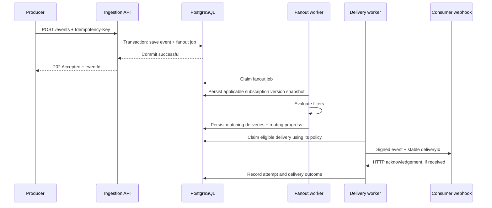

# Event Ingestion and Notification Fanout Architecture

## Overview

The service accepts structured events, durably routes them to matching subscriptions, and delivers signed notifications to consumer webhooks.

The initial architecture uses:

- A stateless REST API for ingestion, subscription management, and audit queries.
- PostgreSQL as the durable system of record and work queue.
- Independently scalable fanout workers and delivery workers.
- Metrics, structured logs, and distributed traces.

```mermaid
flowchart LR
    P[Event producers] --> API[Ingestion API: authenticate and validate]
    API --> ADMIT[Transactional idempotency and queue admission]
    ADMIT -->|New event and available slot| TX[Atomic commit: event + fanout job]
    ADMIT -->|Existing event with matching content| ACK
    ADMIT -->|Queue full| FULL[503 EVENT_QUEUE_FULL with Retry-After]
    FULL --> P
    TX --> EQ[(Durable events and fanout jobs)]
    TX --> ACK[202 Accepted only after commit]
    ACK --> P

    SM[Subscription management API] --> SS[(Versioned subscriptions)]
    EQ --> FW[Fanout workers: claim job and snapshot rules]
    SS --> FW
    FW --> MATCH[Match event type, source, and payload]
    MATCH --> FO[Fanout: persist one delivery per match and routing progress]
    MATCH --> NONE[No matches: mark routing complete]
    NONE --> EQ
    FO --> DS[(Delivery state and due-work queue)]

    DS --> DW[Delivery workers: policy-aware claim]
    DW --> AUTH[Persist attempt authorization before sending]
    AUTH --> AUD[(Delivery audit store)]
    AUTH --> WH[Consumer webhook: signed event and stable delivery ID]
    WH --> RESULT{Observed outcome}
    RESULT -->|HTTP 2xx| OK[Mark delivered]
    RESULT -->|Failure or unknown outcome| POLICY{Delivery policy}
    POLICY -->|At-most-once| STOP[Stop without retry]
    POLICY -->|At-least-once or exactly-once processing| RETRY{Retry permitted?}
    RETRY -->|Yes| BACKOFF[Persist next attempt time: backoff and jitter]
    BACKOFF --> DS
    RETRY -->|No: permanent error or budget exhausted| FAIL[Mark failed]
    STOP --> DS
    OK --> DS
    FAIL --> DS
    RESULT --> AUD
    OK --> AUD
    STOP --> AUD
    BACKOFF --> AUD
    FAIL --> AUD

    OPS[Subscribers and operators] --> QUERY[Delivery status and history APIs]
    DS --> QUERY
    AUD --> QUERY
```



The stores above are logical PostgreSQL tables, not separate databases. Attempt authorization is durable before network I/O; observed outcomes and delivery-state transitions are recorded transactionally. If a worker crashes or cannot persist the outcome, recovery records an unknown outcome and follows the snapshotted delivery policy. An audit-write failure must not be treated as successful completion.

For `exactly_once`, the consumer webhook includes the transactional inbox and business-processing transaction described below. The retry loop still permits repeated HTTP requests.

## End-to-End Event Flow



### 1. Producer Submits an Event

For example, the checkout service sends:

```http
POST /events
Content-Type: application/json
Idempotency-Key: order-123-created
```

```json
{
  "type": "order.created",
  "source": "checkout",
  "payload": {
    "orderId": "123",
    "total": 149.99
  }
}
```

The API authenticates the producer, checks tenant authorization, and validates the event envelope and payload size.

### 2. API Durably Accepts the Event

In one database transaction, the API stores:

- An immutable event with a unique `eventId`.
- A pending fanout job.
- The producer-scoped idempotency key associated with the event.

It returns `202 Accepted` only after commit.

**Accepted means durably stored, not delivered.** If the producer loses the response, it retries with the same idempotency key and receives the existing event ID. Reusing the key with different content returns a conflict.

If the database cannot commit, the API returns an error instead of accepting the event. Database replication, backups, and recovery must meet the required data-loss objective.

#### Bounded Event Admission

`EVENT_QUEUE_CAPACITY` caps unfinished fanout jobs, defaulting to 10000. Pending and processing jobs count; routing completion releases capacity without deleting the accepted event. Retained events and downstream delivery backlog are not capped by this setting.

A transaction-scoped PostgreSQL advisory lock serializes ingestion across replicas. The API checks idempotency first, then capacity, then inserts the event and fanout job atomically. Full queues reject new events with `503`, code `EVENT_QUEUE_FULL`, and `Retry-After: 5`; no rejected event/job is persisted. Matching idempotent retries still return `202`, while conflicting content returns `409`. Object key ordering is ignored in content comparison.

Use the same capacity on every replica. Unfinished-job counting uses a partial index, but the global admission lock and count are an intentional throughput trade-off. Mixed deployments with old code bypassing the gate can invalidate the bound. Database unavailability and delivery-queue growth remain separate failure modes.

### 3. Fanout Worker Finds Matching Consumers

A fanout worker claims the job with a lease and captures a durable snapshot of subscription versions active when routing begins.

Subscriptions support event-type, source, and validated payload conditions. Workers narrow candidates using indexed type/source fields before evaluating payload conditions. Filters cannot execute arbitrary code.

For the example event:

| Consumer | Filter | Match? |
|---|---|---|
| Billing | `type = order.created` | Yes |
| Fraud detection | `type = order.created AND payload.total > 100` | Yes |
| Shipping | `type = order.shipped` | No |

The worker creates two independent deliveries:

```text
Event E1
  |-- Delivery D1 -> Billing
  `-- Delivery D2 -> Fraud detection
```

Each delivery snapshots the destination, subscription version, and delivery policy. A unique constraint on `(event_id, subscription_id)` prevents duplicate delivery records when routing is resumed.

Delivery creation and routing progress commit together. Large fanouts use bounded batches and durable checkpoints. A routing job is complete only after all selected subscriptions have been processed, including events with no matches.

Deleting a subscription excludes it from future routing. Already-created deliveries continue; immediate cancellation is a separate operation.

### 4. Delivery Worker Sends the Notification

A delivery worker processes each delivery independently and sends an envelope such as:

```json
{
  "deliveryId": "D1",
  "eventId": "E1",
  "type": "order.created",
  "source": "checkout",
  "payload": {
    "orderId": "123",
    "total": 149.99
  }
}
```

Timestamped HMAC signature headers let the consumer verify authenticity. Each logical delivery retains the same `deliveryId` across retries.

Use bounded HTTP timeouts, per-endpoint concurrency limits, and tenant quotas. A slow or failing consumer must not monopolize workers or block other consumers.

### 5. Delivery Policy Determines Failure Handling

The delivery policy is configured per subscription and copied to each delivery record. Subscription changes do not silently change existing deliveries.

| Mode | Sender behavior | Guarantee and trade-off |
|---|---|---|
| `at_most_once` | At most one HTTP attempt; never retries | Sender does not repeat an attempt, but notifications can be lost |
| `at_least_once` | Retries until acknowledgement | Duplicate requests are possible; eventual receipt requires receiver recovery and continued retries |
| `exactly_once` | Retried transport with transactional receiver deduplication | Business effects commit once within the compatible receiver's transaction; HTTP requests can repeat |

#### Subscriber Contract and Failure Conditions

Each subscriber selects one mode. The recommended default is `at_least_once`; `exactly_once` requires the receiver contract below. Guarantees apply per logical delivery to one subscription, not globally across consumers, and do not imply event ordering.

| Mode | Failure conditions and recovery | Guarantee boundary |
|---|---|---|
| `at_most_once` | Crash after consuming send authorization but before sending can lose the notification. Timeout, HTTP failure, lost acknowledgement, or crash after sending can leave an unsuccessful or unknown outcome. Never retry or restore authorization. | At most one sender-issued HTTP attempt. Receipt and processing are not guaranteed. Redrive of the same logical delivery is prohibited; an explicit new delivery is outside the original guarantee. |
| `at_least_once` | Retry recoverable failures and unknown outcomes. A crash after receiver processing but before recording acknowledgement can cause duplicate processing. Permanent receiver rejection, exhausted retry budget, cancellation, or an indefinitely unavailable receiver can prevent receipt. | Eventual acknowledgement is conditional on continued retries, recoverable durable state, and a receiver that eventually accepts the request. Bounded retry is not an unconditional eventual-delivery guarantee. |
| `exactly_once` | Retry as for at-least-once. A receiver crash before its transaction commits rolls back processing; a crash or lost acknowledgement after commit leads to a duplicate request that is deduplicated. Lost/expired deduplication records, non-atomic business changes, premature acknowledgements, or non-idempotent external effects can break the guarantee. | Exactly one committed business effect within the compliant receiver's transaction, conditional on eventual processing. HTTP requests may repeat; permanent failure, cancellation, or exhausted retries can result in no committed effect. |

All modes depend on the configured durability of sender storage. Irrecoverable loss of accepted events, delivery state, or consumed send authorizations can invalidate guarantees. Receiver data loss can likewise invalidate exactly-once processing. Backups alone do not prevent acknowledged-write loss during failover; replication and recovery configuration must match the promised durability.

Unknown outcomes are not proof of either receipt or failure. For at-most-once, finish the delivery without resending and expose `failed` with an explicit `unknown` outcome when success cannot be established; this status must not imply the consumer did not process it. For retry-enabled modes, retain the unknown attempt in the audit trail and schedule recovery according to policy.

#### At-Most-Once

```text
Consume single send authorization -> Commit -> Send once -> Record outcome
```

The worker atomically consumes a delivery's single send authorization before issuing the request. Automatic HTTP client and proxy retries are disabled.

If the worker crashes before sending, the notification may be lost. If it crashes after sending, the outcome may be unknown. Neither case allows another attempt, and lease expiration must not restore send authorization.

#### At-Least-Once

```text
Send -> Failure or unknown outcome -> Backoff -> Send again
     -> Successful acknowledgement -> Mark delivered
```

Retry network failures, timeouts, `429`, and retryable server errors using exponential backoff with jitter. Respect bounded `Retry-After` values and document the policy for permanent failures.

The receiver can process a request whose acknowledgement is lost, so a retry may repeat processing. Consumers should deduplicate using `deliveryId`.

Persistent retry until acknowledgement or explicit cancellation differs from bounded retry. A fixed retry budget followed by terminal failure does not guarantee eventual receipt. Explicit redrive preserves the delivery ID and its attempt history.

#### Exactly-Once Processing

Exactly-once processing requires a compatible consumer implementing a transactional inbox:

```text
BEGIN TRANSACTION

Insert deliveryId into inbox with a UNIQUE constraint.

If already processed:
    Use the previously recorded acknowledgement.
Otherwise:
    Apply business changes.
    Mark inbox entry processed.

COMMIT

Return success.
```

Concurrent duplicate requests must be serialized by the inbox uniqueness/locking mechanism. The inbox entry and business changes commit in the same transaction, and success is returned only after commit.

If an acknowledgement is lost, the sender retries. The consumer recognizes the delivery ID and acknowledges it without repeating the business changes.

Receiver requirements:

- Stable delivery IDs scoped to the receiver.
- Durable transactional deduplication.
- Success acknowledgement only after business processing commits.
- Duplicate requests return the recorded successful outcome.
- Deduplication records retained for the entire retry and redrive horizon.

Checking an ID in a cache before processing is insufficient. External side effects also require idempotency or an appropriate transactional outbox; an inbox alone cannot make unrelated external operations exactly once.

Reject `exactly_once` configuration for incompatible receivers rather than silently downgrade it. The sender alone cannot guarantee exactly-once processing over HTTP, and an ordinary HTTP `2xx` does not independently prove that the receiver honored the contract.

### 6. Audit Is Updated Throughout

Persist each attempt's:

- Attempt number and start/end timestamps.
- HTTP response code, when received.
- Latency and categorized error.
- Observed acknowledgement and outcome.

Interrupted requests remain distinguishable as unknown outcomes rather than being reported as successful.

Expose delivery status as `pending`, `delivered`, or `failed`, with additional outcome metadata for uncertain attempts. Record cancellation separately if supported.

Consumers and operators can query:

```http
GET /events/E1/deliveries
GET /subscriptions/{subscriptionId}/deliveries
GET /deliveries/D1
GET /deliveries/D1/attempts
```

Use tenant authorization, cursor pagination, and documented retention periods. Do not retain unrestricted response bodies or secrets.

**Consumer isolation:** Billing can succeed while Fraud detection retries. A failing consumer does not block delivery to other consumers.

## Core Data Model

| Table | Purpose |
|---|---|
| `events` | Immutable accepted events and producer idempotency keys |
| `subscriptions` / `subscription_versions` | Ownership, webhook destinations, filters, policies, and lifecycle |
| `fanout_jobs` | Routing snapshots, progress, leases, and errors |
| `deliveries` | Stable delivery identity, policy, status, next attempt time, and terminal outcome |
| `delivery_attempts` | Append-only attempt history |

## API Surface

| Endpoint | Purpose |
|---|---|
| `POST /events` | Durably accept a structured event |
| `POST /subscriptions` | Register a webhook, filters, and delivery policy |
| `GET /subscriptions` | List subscriptions without restarting the service |
| `DELETE /subscriptions/{id}` | Exclude a subscription from future routing |
| `GET /events/{id}/deliveries` | Query delivery history for an event |
| `GET /subscriptions/{id}/deliveries` | Query delivery history for a subscription |
| `GET /deliveries/{id}` | Query delivery status and outcome |
| `GET /deliveries/{id}/attempts` | Query individual attempts |

## Production Safeguards

- Enforce tenant-scoped authentication and authorization.
- Verify webhook ownership.
- Prevent SSRF by blocking private/internal destinations, validating resolved addresses at connection time, restricting redirects, and enforcing outbound network policy.
- Encrypt signing secrets and support rotation.
- Monitor ingestion rate, routing lag, oldest pending delivery, retries, terminal failures, and webhook latency.
- Correlate logs and traces by event, subscription, delivery, and attempt IDs.
- Alert on backlog growth, stuck routing, elevated failures, and database capacity.
- Support graceful shutdown and policy-aware crash recovery.
- Reject overload before acceptance; never silently discard accepted work.
- Test database backup restoration and disaster recovery.

## Scaling Path

Scale API replicas, fanout workers, and delivery workers independently. Start with PostgreSQL-backed work claiming, such as `FOR UPDATE SKIP LOCKED`, and policy-aware leases.

If measured throughput or database contention justifies a broker, introduce it through a transactional outbox with idempotent consumers. PostgreSQL remains the source of truth; avoid uncoordinated database-to-broker dual writes.

### Moving from One Node to Multiple Nodes

Multiple API and worker nodes can share PostgreSQL; a broker is not required just to add replicas. However, adding nodes introduces concurrent requests, overlapping workers, aggregate resource limits, and partial failures. More workers do not automatically increase throughput once the shared database or consumer becomes the bottleneck.

**Implementation boundary:** the diagrams and mitigations describe the target architecture. The current code provides atomic ingestion/fanout transactions, unique constraints, and row-lock-based work claiming, but does not yet implement every production safeguard below. Its existing tests do not establish multi-node crash safety.

| Scaling challenge | Multi-node failure point and impact | Current implementation and required hardening |
|---|---|---|
| Load balancing and ingestion retries | A producer retries against a different replica after a lost response. Two replicas concurrently check the same idempotency key and attempt insertion. | Transaction-scoped admission locking now coordinates idempotency lookup and insertion; equivalent JSON replays return the existing ID. Preserve this coordination when replacing the global lock for higher throughput. |
| Full event queue | More API replicas can admit work faster than fanout workers route it; independent per-node counts can overshoot a global limit. | `EVENT_QUEUE_CAPACITY` and the shared transactional admission lock bound unfinished fanout jobs. Reject new work with `503` and `Retry-After`; do not reject matching retries of accepted events or silently drop accepted work. |
| Shared database capacity | All replicas compete for database CPU, I/O, WAL, locks, and connections. Adding replicas can increase contention instead of throughput. | Budget total connections across every process, reserve operational headroom, configure connection/acquisition timeouts, consider pooling, and scale against measured database capacity rather than CPU alone. |
| Connection-pool exhaustion | Delivery workers retain a checked-out connection after claim commit while borrowing additional connections for event reads and outcome transactions. Enough concurrent workers can occupy the pool and wait on each other. | Release claim connections before HTTP I/O and subsequent pool operations. Bound worker concurrency against the pool budget. |
| Overlapping polling loops | Each replica runs an asynchronous `setInterval`; a slow iteration can overlap later ticks. Replica count multiplies this uncontrolled concurrency. | Use a non-overlapping scheduler or bounded worker pool; separate API, fanout, and delivery entry points so scaling one workload does not unintentionally scale all three. |
| Lease expiry and stale workers | Worker A stalls beyond its 30-second delivery lease; worker B reclaims the delivery. Both may send, and A can later overwrite B's recorded success with a failure or retry. | `SKIP LOCKED` protects claim transactions, not work after commit. Add claim tokens/generations and conditional outcome updates; renew leases when appropriate and ensure request timeouts fit the lease. Fencing protects stored state, not exactly-once external HTTP effects. |
| At-most-once recovery | A node crashes after consuming its send authorization. Another node must not resend even if no audit outcome exists. | The current pre-send terminal state prevents reclaim, but crashes can leave no attempt history. Persist authorization/attempt start atomically and reconcile unresolved outcomes without restoring authorization. |
| Fanout amplification | Each event scans all active subscriptions and inserts every match in one transaction. Large fanouts hold locks/connections and generate high write volume. | Current fanout is atomic and uniqueness-protected, but unbatched. Add candidate indexes, bounded batches, durable routing snapshots/checkpoints, and event/subscriber quotas. |
| Queue and audit query growth | Multiple pollers repeatedly scan growing job/delivery tables. Unindexed history queries and accumulated completed records compete with ingestion. | A partial unfinished-fanout index supports admission counts. Delivery polling and audit-query indexes still need hardening based on query plans; paginate history and define retention without deleting pending work or required idempotency evidence. |
| Subscription consistency | Concurrent deletion or configuration changes race with routing. Future per-node caches can disagree about eligible subscriptions. | Current fanout reads active subscriptions within a transaction and snapshots delivery destinations, but has no durable versioned routing snapshot. Define the snapshot boundary, persist versions for batched routing, and invalidate/version caches if introduced. |
| Per-consumer limits and fairness | A per-node concurrency limit multiplies across replicas. One hot subscription or tenant can exhaust workers or overwhelm its webhook. | No aggregate endpoint limit currently exists. Use coordinated limits or partition ownership, tenant fairness, bounded work admission, and slow-consumer isolation. |
| Retry storms | Replicas retry many failures at the same deterministic backoff interval, especially after an outage, overwhelming recovered consumers and the database. | Current backoff is exponential and capped but has no jitter or `Retry-After` handling. Add jitter, bounded server-directed delays, fair retry scheduling, and explicit retry-budget/redrive policy. |
| Ordering | Different workers finish events in different orders; retries can deliver an older event after a newer one. | No per-subscription ordering guarantee exists. Document unordered delivery. If ordering is required, serialize within an explicit partition key and define whether a failed event blocks that partition. |
| Network partitions and database failover | A node can reach a consumer but lose database access after sending. Failover may discard acknowledged state if replication is asynchronous; restored send authorization can violate at-most-once. | Treat missing acknowledgements/state writes as unknown, recover according to policy, and choose replication/recovery guarantees explicitly. Receiver deduplication remains necessary for exactly-once processing. |
| Rolling deploys and migrations | Different code versions run together while every replica invokes migration at startup. DDL contention or incompatible schema changes can prevent startup or corrupt assumptions. | Run migrations as one coordinated deployment step and use expand/contract changes compatible with old and new workers. Drain in-flight work; current shutdown exits without explicitly awaiting worker completion. |
| Multi-region deployment | Remote database latency slows claim/commit cycles; regional failure and active-active writes complicate consistency and ownership. | Start with a single write region and failover plan. Use distributed storage only with a defined consistency model, ownership strategy, latency budget, and deduplication scope. |
| Observability and security consistency | Local logs hide cross-node failures; inconsistent credentials, egress rules, or clocks produce different behavior on each replica. | Centralize correlated logs/metrics, track replica/claim/attempt identity, synchronize clocks, and distribute configuration/secrets safely. Apply outbound destination protections on every node. |

### Multi-Node Delivery Guarantees

- **At-most-once:** authorization must be a durable, globally coordinated single-use decision. Node restarts, duplicate work, and lease expiry must never recreate it. Durability loss during failover can invalidate this guarantee.
- **At-least-once:** lease recovery can produce concurrent duplicate requests. Keep the same logical delivery ID and prevent stale workers from regressing terminal success. Eventual acknowledgement remains conditional on receiver recovery and continued retries.
- **Exactly-once processing:** additional sender nodes do not strengthen the guarantee. All receiver replicas must share a transactional deduplication scope with their business changes; a separate in-memory inbox per receiver replica is insufficient.

### Safe Scale-Out Sequence and Verification

1. Preserve atomic queue admission and idempotency when increasing ingestion parallelism, release database connections promptly, and bound/non-overlap worker execution.
2. Add claim fencing, durable pre-send attempt records, crash reconciliation, work/query indexes, and aggregate consumer limits.
3. Separate API and worker deployment roles, place API replicas behind a health-aware load balancer, and coordinate migrations.
4. Run concurrent replicas in integration tests: same-key ingestion races; fanout races; expired leases with a late worker result; at-most-once crash recovery; shared-inbox receiver deduplication; and slow-consumer isolation.
5. Load-test with defined throughput/latency targets. Measure routing lag, oldest pending work, connection wait time, database utilization, duplicate requests, and recovery after killing a worker or interrupting its database connection.
6. Increase replicas only while throughput improves within the database/consumer budget. Introduce a broker through an outbox when measured queue contention or replay requirements justify it.

## Points of Failure and Mitigations

The service must distinguish between **loss**, **duplication**, **delay**, and an **unknown outcome**. An unknown outcome means the network or worker failed before the service could establish whether the consumer processed the request; it must never be reported as a confirmed success.

| Stage | Failure points | Result | Mitigations |
|---|---|---|---|
| Producer and API | Invalid payload, authentication failure, overload, request timeout, lost response, or idempotency-key conflict | Event rejected, or producer cannot tell whether it was accepted | Runtime validation, authentication, admission limits, durable idempotency keys, and retry with the same key |
| Ingestion transaction | Database unavailable, transaction rollback, connection-pool exhaustion, deadlock, replication/failover loss, or storage corruption | Event must not be acknowledged; an accepted event could be lost if durability is misconfigured | Commit event and fanout job atomically, acknowledge only after commit, use HA/replication, backups, restore tests, and explicit error responses |
| Subscription management | Invalid rules, unsafe webhook URL, concurrent update/delete, authorization bug, or secret loss | Incorrect matching, unauthorized delivery, or inability to verify the consumer | Schema validation, HTTPS/SSRF checks, tenant authorization, versioned rules, encrypted secrets, and secret rotation |
| Fanout and matching | Worker crash, stale lease, duplicate job, rule-evaluation bug, unbounded subscription count, or event/subscription change during routing | Missing, duplicate, or delayed delivery records | Leases, `SKIP LOCKED`, unique `(event_id, subscription_id)` constraint, bounded batches, durable checkpoints, indexed candidate selection, and rule-version snapshots |
| Delivery coordination | Worker crash before/after claim, stale lock, queue starvation, clock skew, or database contention | Delayed work, duplicate work, or an unknown send state | Durable delivery state, lease expiry, unique delivery IDs, bounded concurrency, monotonic scheduling assumptions, and reconciliation jobs |
| Webhook transport | DNS/TLS failure, blocked destination, connection reset, timeout, redirect, slow consumer, malformed response, `4xx`, `429`, or `5xx` | Failed, delayed, or unknown delivery; duplicates are possible after lost acknowledgements | HTTPS, SSRF protection, redirect policy, bounded timeouts, response classification, exponential backoff with jitter, `Retry-After`, per-endpoint limits, and circuit breakers |
| Retry processing | Incorrect retry classification, retry storm, non-durable timer, exhausted budget, or permanent receiver rejection | Lost eventual delivery or excessive load | Persist `next_attempt_at`, cap backoff, add jitter, retain attempt history, use explicit terminal failure/redrive, and alert on backlog |
| Audit and status | Attempt write fails, state transition is not atomic with audit, retention failure, or incorrect unknown-outcome handling | Inaccurate operational view or inability to prove what happened | Transactional state/audit updates, append-only attempts, explicit `unknown` outcome, reconciliation queries, retention monitoring, and no fabricated success |
| Security and isolation | Forged signatures, leaked secrets, SSRF, malicious payload/filter, tenant data access bug, or compromised credentials | Unauthorized delivery, data exposure, or internal network access | HMAC signatures, secret encryption/rotation, input limits, restricted filter language, tenant-scoped authorization, outbound network policy, and least-privilege credentials |
| Operations | Bad deployment, migration incompatibility, resource exhaustion, unavailable dependency, missing alerts, or untested failover | Broad outage, backlog growth, or silent degradation | Backward-compatible migrations, graceful shutdown, health checks, metrics/logs/traces, capacity alerts, staged rollout, backups, and disaster-recovery tests |

### Guarantee-Specific Failure Boundaries

- **At-most-once:** the sender consumes authorization before sending. A crash before the HTTP request can lose the notification; a crash after the request can leave an unknown outcome. The sender must not retry either case.
- **At-least-once:** failures and unknown outcomes are retried, so the same delivery can arrive more than once. Permanent rejection, cancellation, exhausted retry budget, or indefinite receiver outage can still prevent delivery.
- **Exactly-once processing:** HTTP requests may repeat. The receiver must transactionally insert the stable `deliveryId`, apply business changes, and record completion in one transaction. Receiver data loss, expired deduplication records, non-atomic business effects, premature acknowledgement, or non-idempotent external side effects breaks the guarantee.

### Detection and Recovery

Monitor ingestion errors, routing lag, oldest pending delivery, retry rate, unknown outcomes, terminal failures, webhook latency, database pool usage, lock contention, and audit-write failures. Alert when backlog or age thresholds are exceeded. Recovery procedures should support worker restart, lease reclamation, explicit redrive, subscription disablement, and database restoration without silently changing a delivery's policy or identity.
