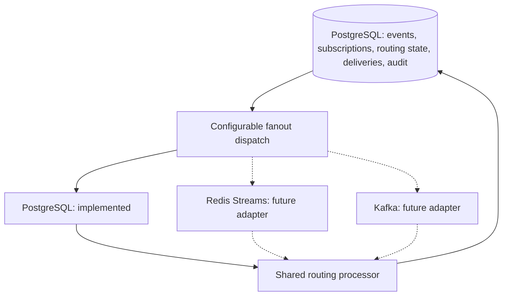
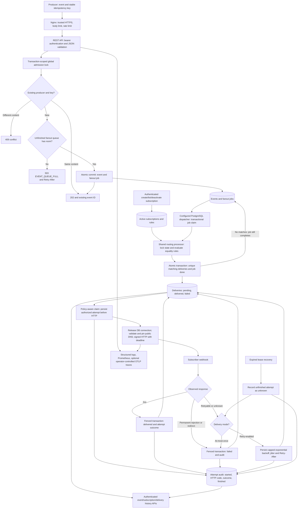

# Implemented architecture, delivery guarantees and failure points

This diagram describes the code that exists, not a proposed managed-queue extension.
Logical stores below are PostgreSQL tables in one database.

## Fanout dispatch boundary



`FANOUT_DISPATCHER=postgresql` is the default and only supported setting today.
Unsupported settings fail startup before accepting events. The dispatcher
interface separates transport from shared routing; PostgreSQL remains authoritative
regardless of a future transport choice. PostgreSQL dispatch claims and routes
within one transaction. The shared processor locks routing state and skips already
completed work, preventing broker duplicates from adding deliveries for later
subscriptions. Future broker adapters must use transactional routing and ACK only
after commit, with durable publication from PostgreSQL jobs/outbox.

## Current end-to-end flow



## Producer to consumer

1. Producer sends `POST /events` with bearer token, `Idempotency-Key`, type, source
   and required arbitrary JSON payload. `X-Producer-Id` namespaces the key.
2. Nginx applies TLS/body/rate limits; the API validates credentials and input.
3. One transaction checks idempotency and queue capacity, then saves event + job.
   Only successful commit allows `202`. Rejection creates no event/job.
4. A worker claims a job. A routing transaction evaluates currently active
   subscriptions and inserts one unique `(event_id, subscription_id)` delivery
   per match, then marks routing done. A no-match event still completes.
5. Each delivery snapshots destination, signing secret and delivery policy.
   Deactivation affects future routing, not already-created deliveries.
6. The delivery claim transaction commits a token, lease and authorized attempt
   before network I/O, releasing its pooled connection before sending.
7. DNS is revalidated and pinned; redirects/client retries are disabled. The signed
   envelope carries stable IDs. The deadline includes DNS and HTTP.
8. A valid `2xx` is acknowledged; otherwise policy determines terminal failure or
   a persisted retry time. Result transactions require the current, unexpired claim.
9. Recovery marks expired unfinished attempts `unknown`. Retry-enabled deliveries
   become due again; at-most-once authorization is never restored.
10. Authenticated audit APIs expose pending/delivered/failed state and attempt
    timestamps, actual response codes when known, errors and unknown outcomes.

**Actual routing boundary:** there are no durable subscription versions or batched
routing checkpoints. A claim recovered before routing commits can observe later
subscription state. Atomic routing prevents partial committed fanout but can be a
long transaction for very large subscription sets.

## Delivery guarantees

| Mode | Sender behavior | Failure boundary |
|---|---|---|
| At-most-once | Consume authorization once, before HTTP; no retry | Crash before sending can lose delivery. Crash/timeout after sending can leave an unknown business effect. Never infer nonreceipt from `failed/unknown`. |
| At-least-once | Retry recoverable HTTP/network failures and unknown attempts without a finite budget | Lost acknowledgement or expired lease can repeat requests. Eventual receipt requires continued workers, surviving durable state and eventual acceptance. Permanent `4xx`/redirect rejection ends delivery. |
| Exactly-once processing | Same retried HTTP, requiring receiver capability declaration | Receiver must transactionally deduplicate delivery ID with its business mutation and acknowledge after commit. Lost dedup records, premature ACK or nontransactional effects break the guarantee. |

```mermaid
sequenceDiagram
    participant W as Sender worker
    participant DB as Sender PostgreSQL
    participant C as Receiver
    participant Inbox as Receiver inbox and business DB
    W->>DB: Commit claim and authorized attempt
    W->>C: Signed event, stable delivery ID
    C->>Inbox: Transaction: unique delivery ID and business mutation
    Inbox-->>C: Commit
    C--xW: ACK lost
    W->>DB: Persist retry or recover expired attempt as unknown
    W->>C: Same delivery ID, potentially repeated HTTP
    C->>Inbox: Find committed ID; do not repeat business mutation
    C-->>W: Successful acknowledgement
    W->>DB: Fenced commit: delivered and actual HTTP code
```

Exactly-once here is a compatible receiver's committed effect, **not exactly one
HTTP request**. The demo's transactional receipt is such an effect; it does not
prove arbitrary external processing. None of the modes implies ordering.

## Failure points and responses

| Failure point | Behavior / response | Protection and remaining limitation |
|---|---|---|
| Producer loses response | Outcome unknown; retry same key | Atomic acceptance and idempotency prevent duplicate stored events |
| Invalid/missing token | `401` | One operator identity; no untrusted-tenant isolation |
| Bad JSON/envelope/headers | `400` | No acceptance; validation details/request ID |
| Body/media type | `413` / `415` | 1MiB body bound |
| Nginx rate limit | `429`, `Retry-After: 5` | Per-source limit, not tenant quota |
| Nginx cannot connect / upstream response deadline | `502` / `504` | Retry the same key: backend commit can be ambiguous; brief restart downtime is observable |
| Conflicting key reuse | `409` | Same-content retries remain valid |
| Event queue full | `503 EVENT_QUEUE_FULL`, `Retry-After: 5` | Atomic cross-node capacity gate; delivery backlog/storage remain uncapped |
| DB connection/resource/transaction outage | Retryable `503`; readiness `503` | No success-shaped acceptance; ambiguous commit reconciled by same key |
| Unexpected internal fault | Sanitized `500` with request ID | Logs preserve diagnostic errors, not bearer/signing secrets |
| Fanout crash before transaction commit | No partial fanout; claim can expire and recover | Unique deliveries; subscription view may change on recovery |
| Crash after attempt authorization | Persistent started attempt becomes unknown | At-most-once never resends; retry-enabled modes may duplicate |
| DNS rebinding/private or mixed destination | No request to prohibited address | Every-attempt validation and pinned connection; OS egress policy is additional defense |
| Redirect | Terminal failure; no follow | Prevents redirect-based SSRF and hidden client retries |
| Timeout/network failure/408/425/429/5xx | Retry unless at-most-once | Persisted backoff + jitter, bounded Retry-After; no finite retry budget |
| Permanent receiver rejection | Failed with audit | Accepted event retained; guarantee is conditional on receiver acceptance |
| Outcome persistence fails | Attempt stays unfinished for recovery | Never fabricate delivered; eventual retry can duplicate |
| Old worker completes after lease expiration | Result ignored by token/expiry fence | Cannot overwrite current/terminal success; cannot retract an already sent HTTP effect |
| Process restart/SIGTERM | Supervisor restarts on failure; graceful drain on termination | Durable jobs/history survive process restart; forced kill can create unknowns |
| TLS certificate renewal fails | HTTPS eventually becomes unavailable | Short-lived IP certificate, hourly timer, validated ACME dry-run; monitor expiry operationally |
| Monitoring/collector failure | Processing remains independent of tracing export | Private Prometheus; paging needs Alertmanager configuration |
| Database disk/host irrecoverably lost | Guarantees can be invalidated | Local WAL durability is not replicated disaster recovery; off-host restore/RPO testing remains next |

Unknown outcomes have no invented HTTP code. `failed` can mean an unknowable
consumer effect under at-most-once, not proof that the consumer did nothing.
Bearer authorization and signing secrets are omitted from API/audit projections.

## Single-node to multiple-node scaling

| Challenge | Current coordination | Scaling failure boundary / next hardening |
|---|---|---|
| Concurrent ingress | Global transaction-scoped advisory lock | Serializes throughput; identical capacity/protocol required on all replicas |
| Concurrent delivery/fanout claims | Row locking, lease and claim token | Expiration recovers work; stale results fenced but duplicate HTTP remains possible |
| Database pool multiplication | 10 connections/process, released before HTTP | Budget replicas against DB limits; avoid simultaneous migration DDL |
| Overlapping polling cycles | Bounded serial, nonoverlapping batches | Default main: 4 fanouts and 4 deliveries/cycle, 500ms interval; split fleets if measured throughput requires |
| Large fanout | Atomic scan/insert transaction, unique pair constraint | Long transactions and rule scans; add indexed candidate narrowing/versioned checkpoints next |
| Slow receiver | Absolute timeout; no DB connection held | Bounded serial workers still reduce aggregate throughput; per-endpoint concurrency/circuit breakers next |
| Subscription changes | Active rules at routing time; delivery configuration copied | No ingest-time/versioned snapshot guarantee |
| Retry storms | Persisted jitter and bounded Retry-After | Unbounded retained backlog; add quotas/retention and endpoint isolation |
| Load balancer/node loss | Any API node can read shared durable state | No in-memory acceptance dependency; PostgreSQL remains the shared availability bottleneck |
| Database failover | Not deployed | Must preserve acknowledged writes and consumed authorizations; test replication/RPO before promising HA |
| Audit growth and pagination | Bounded pages, latest 100 embedded attempts | Retention/partitioning and cursor pagination next |
| Multiple identities | Single operator bearer token | Add ownership-scoped authorization before supporting mutually untrusted tenants |

Nginx and PostgreSQL are single points of availability in this deployment.
No managed queue, ordering or replay extension is implemented. Metrics/logs,
lease recovery and atomic transactions improve diagnosability/recovery; they do
not turn one host into a highly available cluster.
